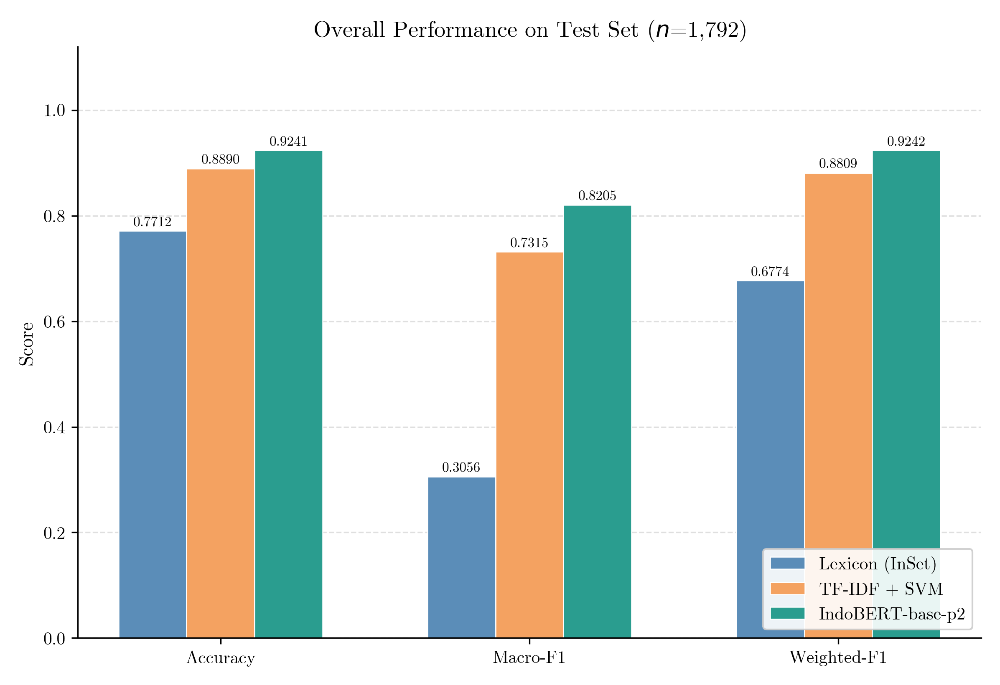
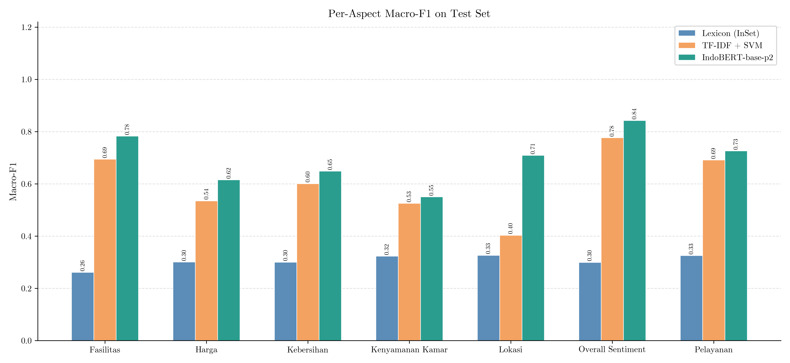
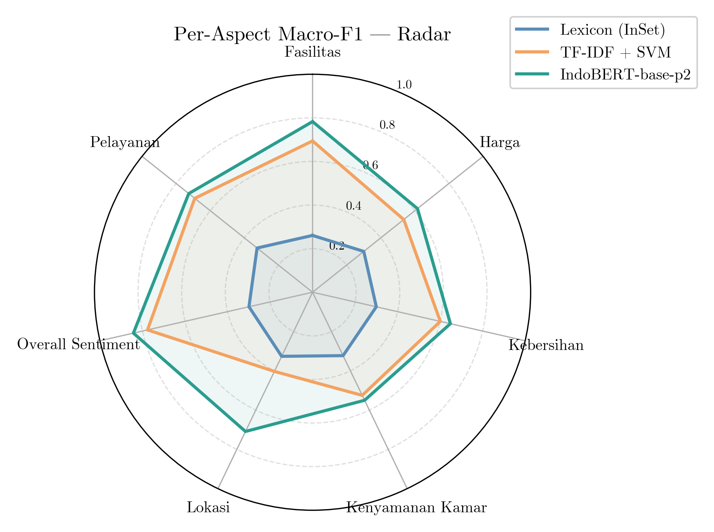
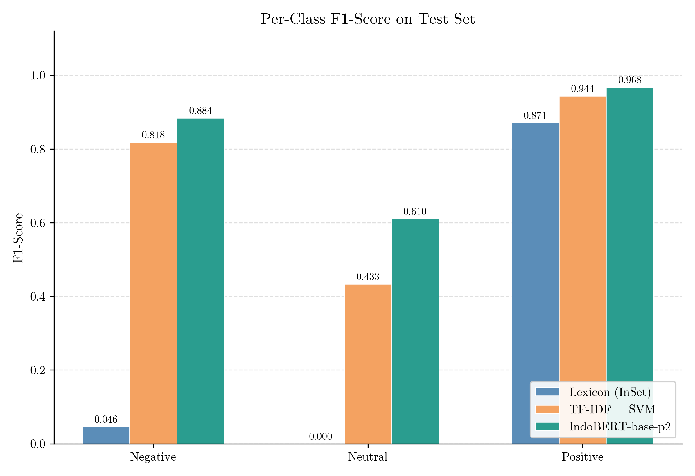
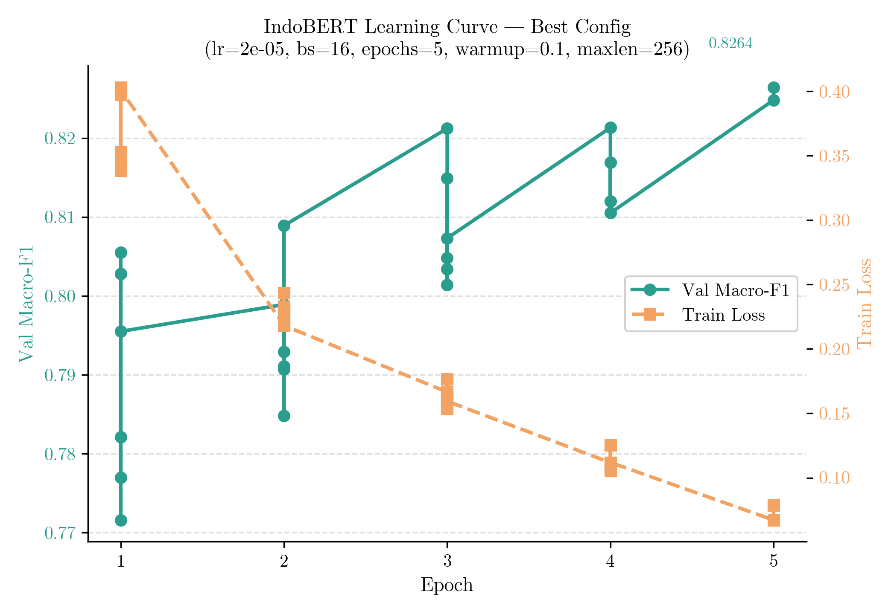
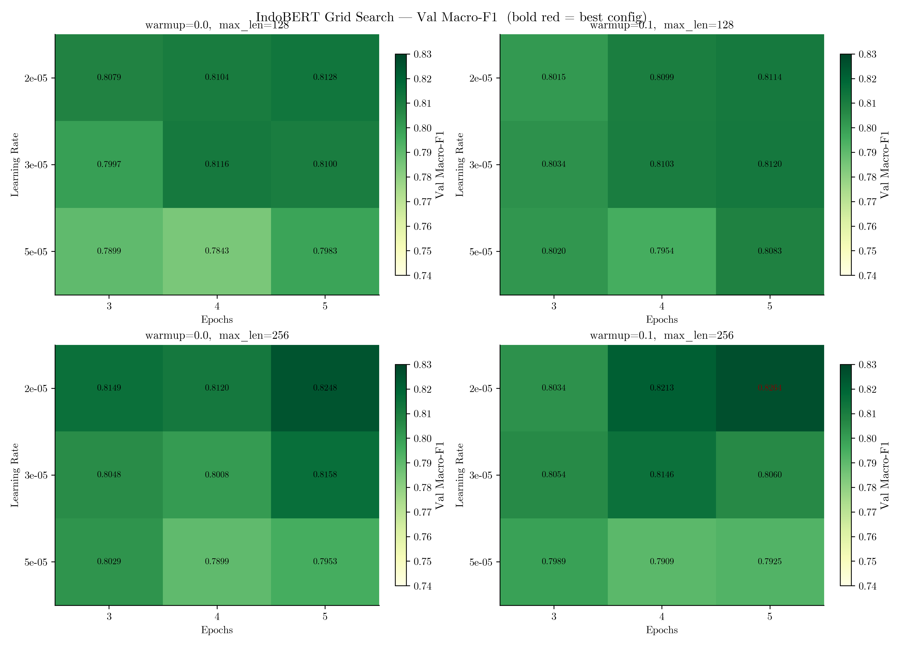
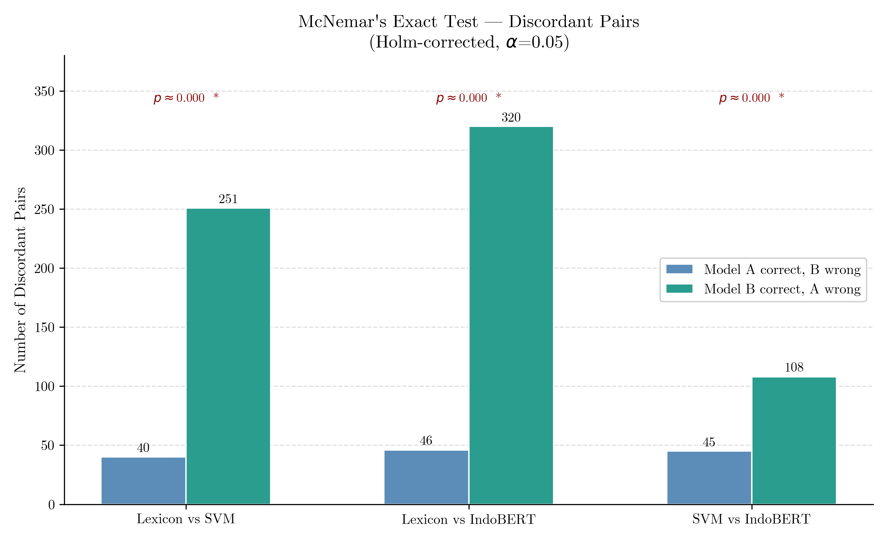

# Aspect-Based Sentiment Analysis on Indonesian Hotel Reviews in Malang

A comparative study of three approaches for Aspect-Based Sentiment Analysis (ABSA) on Indonesian hotel reviews: rule-based lexicon (InSet), TF-IDF + SVM, and fine-tuned IndoBERT.

---

## Research Questions

- **RQ1**: Which approach achieves the best Macro-F1 on the held-out test set across 7 hotel review aspects?
- **RQ2**: Are the performance differences between approaches statistically significant (McNemar's exact test + Holm correction)?
- **RQ3**: How does each approach perform across individual aspects (kebersihan, pelayanan, fasilitas, lokasi, harga, kenyamanan_kamar, overall_sentiment)?

---

## Repository Structure

```
2026-hotel-mlg-absa/
├── src/
│   ├── export_dataset_label_studio.py   # export & majority vote from Label Studio
│   ├── eda.py                           # exploratory data analysis
│   ├── kappa_score.py                   # inter-annotator agreement
│   ├── 01_prepare_data.py               # build pairs, split 70:15:15, validate
│   ├── 02_run_lexicon.py                # lexicon inference on val + test
│   ├── 03_train_svm.py                  # TF-IDF + SVM grid search
│   ├── 04_train_indobert.py             # IndoBERT-base-p2 fine-tuning
│   ├── 05_evaluate_test.py              # evaluate 3 models + McNemar + Holm
│   ├── 06_infer_full_dataset.py         # full dataset inference
│   ├── data/                            # data loading & splitting modules
│   ├── models/                          # lexicon_model, svm_model, indobert_model
│   ├── evaluation/                      # metrics, confusion_matrix, significance_test
│   ├── preprocessing/                   # text_preprocessing per model
│   └── inference/                       # predict_all (reusable inference module)
├── configs/
│   ├── experiment.yaml                  # seed, split ratio, aspects, labels
│   ├── lexicon.yaml                     # negation window, intensifiers, no_match policy
│   ├── svm.yaml                         # TF-IDF + SVM hyperparameter grid
│   └── indobert.yaml                    # LR, batch_size, epochs, max_length grid
├── lexicons/
│   ├── hotel_domain_lexicon.csv         # domain-specific sentiment words
│   └── aspect_terms.csv                 # aspect keyword lists per category
├── data/
│   ├── raw/                             # dataset.csv (majority vote) + annotations.csv
│   └── processed/                       # train/validation/test splits
├── outputs/
│   ├── logs/                            # best_params.json + tuning CSVs
│   ├── metrics/                         # overall, per_class, per_aspect, reports
│   ├── models/                          # svm_pipeline.pkl + indobert_best/
│   ├── predictions/                     # pred_{model}_{split}.csv
│   └── figures/                         # confusion matrices + EDA figures
├── environment.yml
└── experiment_run.md                    # step-by-step commands
```

---

## Approaches

### 1. Lexicon (InSet)
Rule-based scoring using the [Indonesian Sentiment Lexicon (InSet)](https://github.com/fajri91/InSet) combined with a hotel-domain lexicon. Aspect-aware context extraction with a ±5 token window around aspect keywords. Negation, intensifier, and diminisher rules applied. No training required.

### 2. TF-IDF + SVM
sklearn Pipeline (TfidfVectorizer → SVC). Input format: `[ASPEK] {aspect} [ULASAN] {review_text}`. Grid search over 96 combinations of ngram_range, min_df, max_df, sublinear_tf, C, kernel, class_weight. Best config selected by Macro-F1 on validation set.

**Best config** (96 combos): `ngram=(1,2)`, `min_df=2`, `max_df=0.9`, `sublinear_tf=True`, `kernel=linear`, `C=1`

### 3. IndoBERT-base-p2
Fine-tuned [`indobenchmark/indobert-base-p2`](https://huggingface.co/indobenchmark/indobert-base-p2) for 3-class sequence classification. Same input format as SVM. Grid search over 36 combinations of learning_rate, batch_size, epochs, warmup_ratio, max_length. Best config selected by Macro-F1 on validation set. Early stopping patience=2.

**Best config** (36 combos): `lr=2e-5`, `batch_size=16`, `epochs=5`, `warmup_ratio=0.1`, `max_length=256` → val Macro-F1 = 0.8264

---

## Dataset

- **Source**: Hotel reviews in Malang, exported from Label Studio (project ID 2)
- **Reviews**: 3,574 unique reviews
- **Annotators**: 3 annotators
- **Aspects**: kebersihan, pelayanan, fasilitas, lokasi, harga, kenyamanan_kamar, overall_sentiment
- **Labels**: Positive, Negative, Neutral, Not Mentioned
- **Resolution**: majority vote per aspect across 3 annotators
- **Training labels**: positive, negative, neutral (Not Mentioned excluded)
- **Review-aspect pairs**: ~11,840 (after excluding Not Mentioned)
- **Split**: 70:15:15 by `review_id` (GroupShuffleSplit, seed=42) — no data leakage across aspects of the same review

**Inter-annotator agreement (Fleiss' Kappa):**

| Aspect | κ | Interpretation |
|--------|---|----------------|
| kebersihan | 0.852 | Almost Perfect |
| pelayanan | 0.801 | Almost Perfect |
| fasilitas | 0.776 | Substantial |
| lokasi | 0.763 | Substantial |
| harga | 0.712 | Substantial |
| overall_sentiment | 0.698 | Substantial |
| kenyamanan_kamar | 0.445 | Moderate |

---

## Training Configuration

| | Lexicon | SVM | IndoBERT |
|--|---------|-----|---------|
| Preprocessing | lowercase, slang norm, negation preserved | TF-IDF (1-2gram), slang norm | minimal (unicode norm, repeated chars) |
| Hyperparameter search | — | 96 combos | 36 combos |
| Selection metric | — | Macro-F1 (val) | Macro-F1 (val) |
| Hardware | CPU | CPU | Quadro RTX 8000 (48GB) |

**IndoBERT grid:**
- `learning_rate`: [2e-5, 3e-5, 5e-5]
- `batch_size`: [16]
- `epochs`: [3, 4, 5] + early stopping (patience=2)
- `warmup_ratio`: [0.0, 0.1]
- `max_length`: [128, 256]
- Optimizer: AdamW, weight_decay=0.01, fp16

---

## Environment

```
Python      : 3.11
PyTorch     : 2.6.0+cu124
transformers: 4.54.1
scikit-learn: 1.7.1
pandas      : 2.3.1
Hardware    : Quadro RTX 8000 (48 GB VRAM), CUDA 12.4
Conda env   : ksn_nlp_task
```

---

## Reproduction

```bash
conda activate ksn_nlp_task
cd 2026-hotel-mlg-absa
```

```bash
python src/export_dataset_label_studio.py   # export from Label Studio
python src/eda.py                           # exploratory data analysis
python src/kappa_score.py                   # inter-annotator agreement
python src/01_prepare_data.py               # split 70:15:15
python src/02_run_lexicon.py                # lexicon inference
python src/03_train_svm.py                  # SVM grid search
python src/04_train_indobert.py             # IndoBERT fine-tuning (~1.5 hrs, RTX 8000)
python src/05_evaluate_test.py              # evaluation + McNemar + Holm
python src/06_infer_full_dataset.py         # full dataset inference
```

---

## Results

### Overall (Test Set, n=1,792)

| Model | Accuracy | Macro-P | Macro-R | **Macro-F1** | Weighted-F1 |
|-------|----------|---------|---------|--------------|-------------|
| Lexicon (InSet) | 0.7712 | 0.5077 | 0.3401 | 0.3056 | 0.6774 |
| TF-IDF + SVM | 0.8890 | 0.7726 | 0.7030 | 0.7315 | 0.8809 |
| **IndoBERT-base-p2** | **0.9241** | **0.8191** | **0.8219** | **0.8205** | **0.9242** |



> **Figure 1.** IndoBERT-base-p2 outperforms all models across every metric. The largest gap is in Macro-F1: Lexicon scores only 0.3056 as word-level lexicons cannot capture aspect context, while SVM (0.7315) leverages n-gram patterns. IndoBERT (0.8205) closes most of the remaining gap through contextual representations. The relatively high Weighted-F1 of Lexicon (0.6774) compared to its Macro-F1 reflects a strong bias toward the majority class (*positive*).

---

### Per-Aspect Macro-F1 (Test Set)

| Aspect | n | Lexicon | SVM | IndoBERT |
|--------|---|---------|-----|----------|
| fasilitas | 314 | 0.2607 | 0.6942 | **0.7829** |
| harga | 78 | 0.3005 | 0.5350 | **0.6154** |
| kebersihan | 214 | 0.2999 | 0.6009 | **0.6484** |
| kenyamanan_kamar | 129 | 0.3227 | 0.5251 | **0.5501** |
| lokasi | 193 | 0.3263 | 0.4031 | **0.7089** |
| overall_sentiment | 537 | 0.2991 | 0.7762 | **0.8426** |
| pelayanan | 327 | 0.3254 | 0.6909 | **0.7260** |
| **Average** | | 0.3049 | 0.6036 | **0.7249** |



> **Figure 2.** IndoBERT consistently outperforms across all aspects. The largest gain from SVM to IndoBERT is on `lokasi` (+0.306) — this aspect requires deep contextual understanding as location reviews are often implicit (e.g., "close to the city center" with no explicit sentiment word). `kenyamanan_kamar` is the most difficult aspect for all models (Fleiss' κ = 0.445, lowest), reflecting higher annotation ambiguity.



> **Figure 3.** The radar chart clarifies the strength distribution of each model. Lexicon forms a very small, uniform area — it does not dominate any aspect. SVM forms a larger polygon but is concave at `lokasi` and `harga`. IndoBERT spans the widest and most symmetric area, with its relative weakness at `kenyamanan_kamar` consistent with the higher data ambiguity for that aspect.

---

### Per-Class F1 (Test Set)



> **Figure 4.** All models struggle with the *neutral* class — the smallest and most ambiguous class (only 159 samples in the test set). Lexicon barely recognizes *negative* reviews (low F1) as its negative sentiment lexicon does not cover many subtle critical expressions in Indonesian hotel reviews. IndoBERT improves *neutral* F1 from 0.000 (Lexicon) to 0.610, but it still falls well below *positive* (0.968), indicating room for improvement with class-balancing techniques.

---

### IndoBERT Training Dynamics



> **Figure 5.** Learning curve for the best configuration (`lr=2e-5`, `maxlen=256`, `warmup=0.1`). Val Macro-F1 increases monotonically across 5 epochs with no sign of overfitting, while train loss decreases consistently (0.353 → 0.079). With ~8,300 training pairs, 5 epochs still appears to be in a mild underfitting regime — additional epochs or data augmentation may yield further gains.



> **Figure 6.** The grid search heatmap shows `max_length=256` consistently yields higher Macro-F1 than `max_length=128` across all LR and epoch combinations. Learning rate `2e-5` is the most stable; `5e-5` tends to degrade at `max_length=128`. Warmup ratio `0.1` provides a small but consistent advantage over no warmup, especially with fewer epochs.

---

### Statistical Significance



> **Figure 7.** McNemar's test confirms that all pairwise model differences are statistically significant (p ≈ 0.000, Holm-corrected). The *Lexicon vs IndoBERT* pair has the largest number of discordant pairs (366), reinforcing that the prediction difference between these two models is not due to chance. The *SVM vs IndoBERT* pair has 153 discordant pairs — fewer, but still significant — indicating IndoBERT consistently corrects cases that SVM misclassifies.

---

## Conclusion

IndoBERT-base-p2 achieves the best performance across all metrics, with a test Macro-F1 of **0.8205** — a **+0.5149** improvement over the lexicon baseline (0.3056) and **+0.0890** over TF-IDF+SVM (0.7315). All pairwise differences are statistically significant (McNemar's exact test, Holm-corrected).

The lexicon approach struggles on aspects with low intrinsic polarity (e.g., `lokasi`, `harga`) where contextual understanding is critical. SVM shows strong performance on high-frequency aspects (e.g., `overall_sentiment`, `fasilitas`) but falls short on `lokasi` (Macro-F1 = 0.4031), likely due to sparse aspect-specific vocabulary in the training data. IndoBERT's pre-trained contextual representations produce consistent gains across all 7 aspects, with the largest improvement on `lokasi` (+0.3058 vs SVM).

The *neutral* class remains challenging for all models due to class imbalance and annotation ambiguity (`kenyamanan_kamar` Fleiss' κ = 0.445). Future work may benefit from data augmentation, aspect-specific pre-training, or addressing class imbalance through oversampling.

**Best IndoBERT config:** `lr=2e-5`, `batch_size=16`, `epochs=5`, `warmup_ratio=0.1`, `max_length=256` (val Macro-F1 = 0.8264, 36 combos searched).

---

## License

This repository is for academic research purposes.
