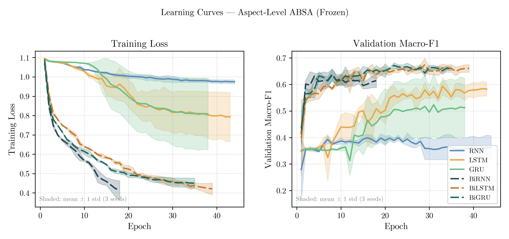
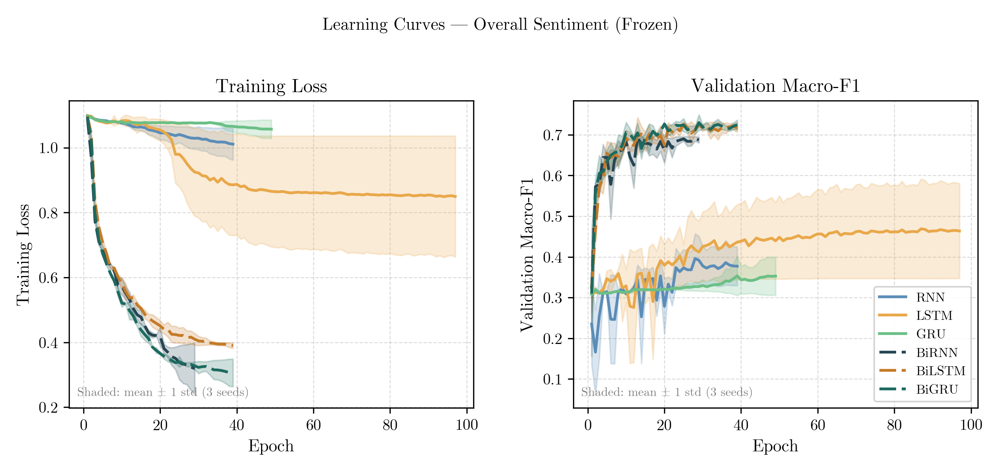
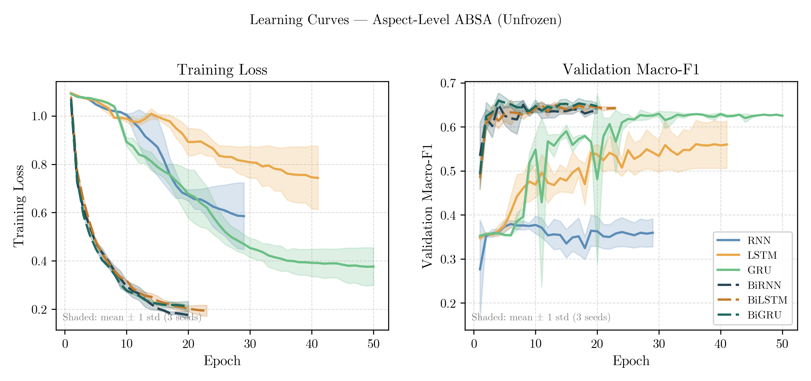
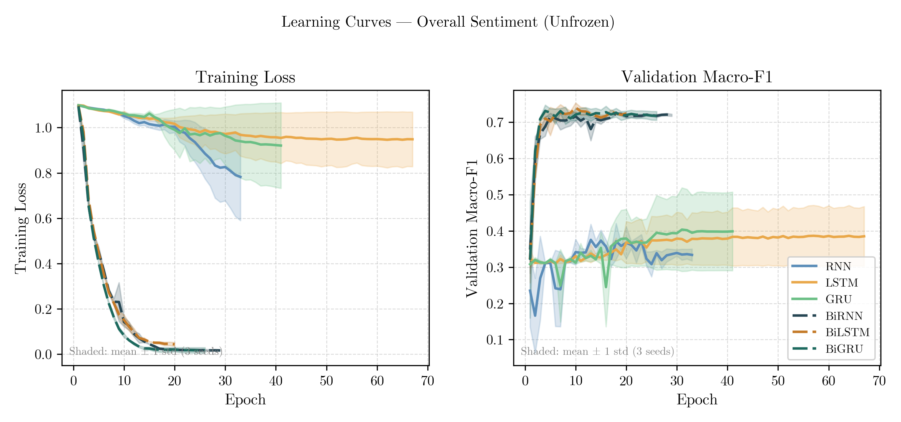
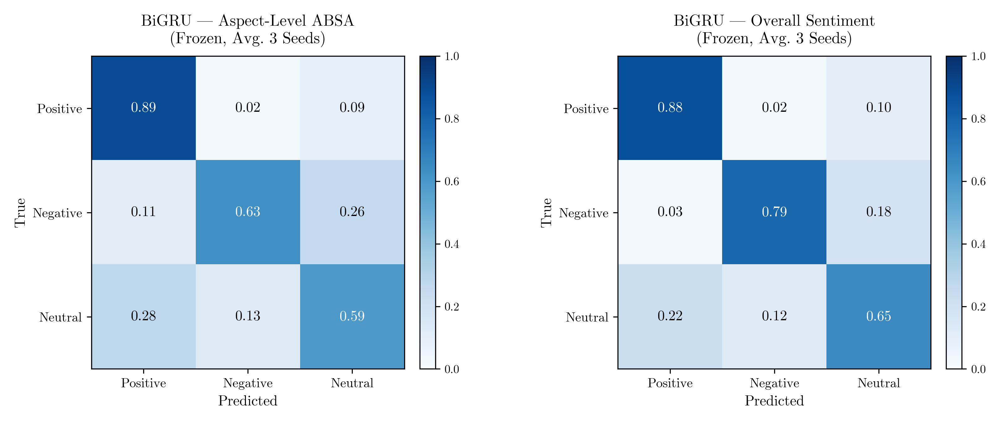
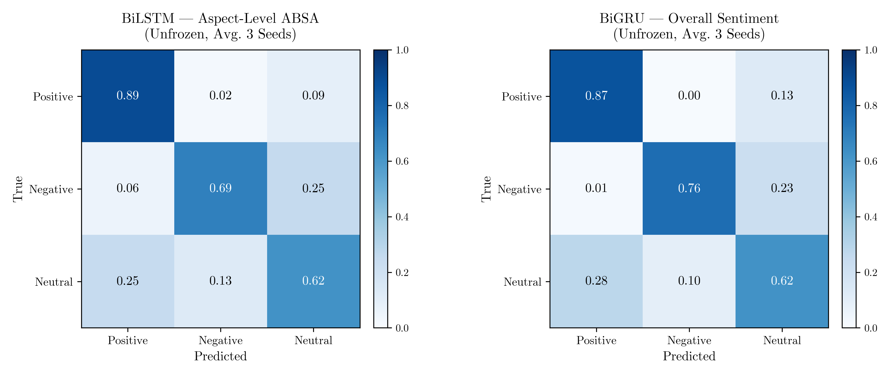

# Analisis Komparatif Arsitektur Berbasis RNN untuk Aspect-Based Sentiment Analysis pada Ulasan Hotel Kota Malang

## 1. Pendahuluan

Analisis sentimen berbasis aspek (*Aspect-Based Sentiment Analysis*/ABSA) merupakan tugas NLP yang bertujuan mengidentifikasi sentimen pengguna terhadap aspek-aspek spesifik dari suatu entitas. Berbeda dengan analisis sentimen umum, ABSA memberikan informasi yang lebih granular karena memisahkan penilaian berdasarkan dimensi tertentu — misalnya kebersihan, pelayanan, atau fasilitas pada ulasan hotel.

Pemilihan arsitektur model merupakan keputusan kritis dalam membangun sistem ABSA. Keluarga model *Recurrent Neural Network* (RNN) — termasuk LSTM dan GRU beserta varian bidirectional-nya — telah lama menjadi fondasi pemrosesan teks sekuensial, namun perbandingan sistematis antara arsitektur ini untuk teks berbahasa Indonesia masih terbatas, khususnya pada domain ulasan hotel.

Penelitian ini membandingkan enam arsitektur RNN untuk dua skenario klasifikasi sentimen pada ulasan hotel Malang:

- **Eksperimen A (Aspect-Level ABSA):** Klasifikasi sentimen (positif/negatif/netral) untuk tiap aspek secara eksplisit. Input dikonstruksi sebagai `[ASPEK] {aspek} [ULASAN] {teks ulasan}`.
- **Eksperimen B (Overall Sentiment):** Klasifikasi sentimen keseluruhan ulasan tanpa dekomposisi aspek.

### Research Questions

**RQ1.** Arsitektur mana (RNN, LSTM, GRU, BiRNN, BiLSTM, BiGRU) yang menghasilkan performa terbaik untuk ABSA ulasan hotel berbahasa Indonesia, baik pada tingkat aspek maupun sentimen keseluruhan?

**RQ2.** Apakah bidirectionality memberikan keuntungan yang konsisten dan signifikan dibandingkan arsitektur unidirectional pada tugas ABSA?

**RQ3.** Bagaimana pengaruh strategi embedding — frozen vs. unfrozen fastText — terhadap performa dan stabilitas model, terutama pada dataset berukuran kecil-menengah?

**RQ4.** Apakah pola performa model konsisten antara tugas aspect-level ABSA (Eksperimen A) dan overall sentiment classification (Eksperimen B)?

---

## 2. Dataset

- **Sumber:** Ulasan hotel di Malang, Indonesia (Google Maps)
- **Aspek (Eksperimen A):** kebersihan, pelayanan, fasilitas, lokasi, harga, kenyamanan_kamar (6 aspek)
- **Label sentimen:** positif, negatif, netral
- **Split:** train / validation / test (rasio ~70 / 15 / 15%)
- **Preprocessing:** lowercase, normalisasi Unicode (NFKC), normalisasi karakter berulang, kamus slang informal (59 entri), tokenisasi whitespace

### 2.1 Distribusi Data — Eksperimen B (Overall Sentiment)

| Split | Total | Positif | Negatif | Netral |
|---|---|---|---|---|
| Train | 2.501 | 1.676 (67,0%) | 347 (13,9%) | 478 (19,1%) |
| Validation | 536 | 372 (69,4%) | 77 (14,4%) | 87 (16,2%) |
| Test | 537 | 375 (69,8%) | 80 (14,9%) | 82 (15,3%) |
| **Total** | **3.574** | **2.423 (67,8%)** | **504 (14,1%)** | **647 (18,1%)** |

Distribusi konsisten antar split. Kelas **positif sangat dominan** (~67–70%), menjadikan class-weighted loss krusial untuk menghindari model bias ke mayoritas.

### 2.2 Distribusi Data — Eksperimen A (Aspect-Level ABSA)

| Split | Total | Positif | Negatif | Netral |
|---|---|---|---|---|
| Train | 5.751 | 4.551 (79,1%) | 762 (13,2%) | 438 (7,6%) |
| Validation | 1.260 | 1.007 (79,9%) | 164 (13,0%) | 89 (7,1%) |
| Test | 1.255 | 1.006 (80,2%) | 172 (13,7%) | 77 (6,1%) |
| **Total** | **8.266** | **6.564 (79,4%)** | **1.098 (13,3%)** | **604 (7,3%)** |

Ketidakseimbangan kelas lebih ekstrem dibanding Eksperimen B: positif mendominasi ~80% dan netral hanya ~6–8%. Ini menjelaskan mengapa Macro-F1 (rata-rata tidak tertimbang) menjadi metrik lebih informatif daripada accuracy — accuracy tinggi dapat dicapai hanya dengan memprediksi "positif" hampir selalu.

---

## 3. Arsitektur Model

Terdapat dua kerangka arsitektur yang digunakan, berbeda pada lapisan RNN dan dimensi hidden state yang dihasilkan.

### 3.1 Unidirectional (RNN / LSTM / GRU)

```
Input (B, 128)
  → Embedding Layer         (B, 128, 300)
  → RNN / LSTM / GRU        2 layer, hidden=256, unidirectional
  → Last Hidden hn[-1]      (B, 256)
  → Dropout (p=0.2)
  → Linear 256 → 3
  → Output: Positive / Negative / Neutral
```

Hidden state yang diambil adalah output layer terakhir pada time step terakhir: `hn[-1]` berukuran (B, 256).

### 3.2 Bidirectional (BiRNN / BiLSTM / BiGRU)

```
Input (B, 128)
  → Embedding Layer                      (B, 128, 300)
  → BiRNN / BiLSTM / BiGRU               2 layer, hidden=256 per arah
  → Concat(hn[-2], hn[-1])               (B, 512)   ← fwd last + bwd last
  → Dropout (p=0.2)
  → Linear 512 → 3
  → Output: Positive / Negative / Neutral
```

Pada bidirectional, `hn[-2]` adalah hidden state forward arah pada layer terakhir, dan `hn[-1]` adalah hidden state backward arah pada layer terakhir. Keduanya digabungkan (concatenate) menghasilkan representasi 512-dim.

### 3.3 Komponen Bersama

| Komponen | Detail |
|---|---|
| Embedding | fastText cc.id.300.bin (Common Crawl Indonesia), dim=300 |
| Kondisi embedding | Frozen (bobot tetap) atau Unfrozen (fine-tune bersama model) |
| Jumlah layer RNN | 2 layer |
| Hidden size per arah | 256 |
| Inter-layer dropout | 0.2 (hanya aktif jika num_layers > 1) |
| Post-hidden dropout | 0.2 (sebelum layer linear) |
| Max sequence length | 128 token (padding / truncation) |
| Vocab | Dibangun dari train+validation, min_freq=1 |

---

## 4. Konfigurasi Pelatihan

| Parameter | Nilai |
|---|---|
| Optimizer | Adam |
| Learning rate | 1×10⁻⁴ |
| Batch size | 32 |
| Max epochs | 100 |
| Early stopping patience | 10 epoch (berbasis val Macro-F1) |
| LR scheduler | ReduceLROnPlateau (mode=max, factor=0.5, patience=3, min_lr=1e-6) |
| Loss function | CrossEntropyLoss dengan class weight (balanced) |
| Gradient clipping | max_norm=5.0 |
| Seeds | 42, 123, 456 |
| Metrik seleksi model | Val Macro-F1 (best seed) |
| Framework | PyTorch 2.6.0+cu124 |
| Environment | conda ksn_nlp_task (Python 3.10) |

**Class weighting:** Bobot kelas dihitung dengan skema `balanced` dari scikit-learn (`compute_class_weight`) berdasarkan distribusi kelas pada training set, kemudian digunakan sebagai `weight` pada `CrossEntropyLoss`. Ini penting mengingat distribusi kelas sentimen pada ulasan hotel cenderung tidak seimbang (bias ke positif).

---

## 5. Hasil Eksperimen

### 5.1 Eksperimen A — Aspect-Level ABSA

**Tabel 1.** Hasil test set Eksperimen A (mean ± std, 3 seed).

| Arsitektur | Embedding | Accuracy | Macro-F1 |
|---|---|---|---|
| RNN | Frozen | 73.04 ± 1.04% | 38.46 ± 2.29% |
| RNN | Unfrozen | 72.38 ± 6.06% | 36.53 ± 1.87% |
| LSTM | Frozen | 79.34 ± 1.50% | 58.41 ± 2.01% |
| LSTM | Unfrozen | 82.02 ± 1.92% | 57.57 ± 5.40% |
| GRU | Frozen | 79.20 ± 2.00% | 51.78 ± **11.46%** |
| GRU | Unfrozen | 79.42 ± 1.14% | 62.74 ± 1.19% |
| BiRNN | Frozen | 82.68 ± 0.59% | 63.81 ± 0.10% |
| BiRNN | Unfrozen | 85.58 ± 0.85% | 67.45 ± 1.21% |
| BiLSTM | Frozen | 83.80 ± 0.63% | 65.49 ± 0.88% |
| **BiLSTM** | **Unfrozen** | **84.81 ± 0.82%** | **68.12 ± 1.09%** |
| BiGRU | Frozen | 83.67 ± 0.30% | 65.81 ± 0.54% |
| BiGRU | Unfrozen | 85.26 ± 1.02% | 67.91 ± 1.90% |

> **Model terbaik (Macro-F1):** BiLSTM Unfrozen — **68.12 ± 1.09%**

### 5.2 Eksperimen B — Overall Sentiment

**Tabel 2.** Hasil test set Eksperimen B (mean ± std, 3 seed).

| Arsitektur | Embedding | Accuracy | Macro-F1 |
|---|---|---|---|
| RNN | Frozen | 65.98 ± 3.70% | 37.44 ± 4.13% |
| RNN | Unfrozen | 66.42 ± 3.78% | 37.20 ± 1.03% |
| LSTM | Frozen | 75.23 ± 3.84% | 52.01 ± 7.25% |
| LSTM | Unfrozen | 72.63 ± 3.72% | 40.68 ± **9.66%** |
| GRU | Frozen | 67.91 ± 3.25% | 36.70 ± 3.27% |
| GRU | Unfrozen | 71.20 ± 1.40% | 40.88 ± **8.90%** |
| BiRNN | Frozen | 81.75 ± 0.92% | 72.59 ± 0.50% |
| BiRNN | Unfrozen | 80.94 ± 0.23% | 71.77 ± 0.43% |
| BiLSTM | Frozen | 80.45 ± 1.79% | 72.33 ± 0.86% |
| BiLSTM | Unfrozen | 81.56 ± 2.21% | 72.42 ± 1.72% |
| **BiGRU** | **Frozen** | **83.36 ± 0.46%** | **75.67 ± 1.12%** |
| BiGRU | Unfrozen | 81.38 ± 0.15% | 73.94 ± 0.85% |

> **Model terbaik (Macro-F1):** BiGRU Frozen — **75.67 ± 1.12%**

---

## 6. Analisis

### 6.1 RQ1 — Arsitektur Terbaik

Bidirectional GRU (BiGRU) merupakan arsitektur yang paling konsisten unggul: terbaik di Eksperimen B (75.67% Macro-F1) dan peringkat dua di Eksperimen A (67.91%). BiLSTM Unfrozen unggul tipis di Eksperimen A (68.12%), namun keunggulan tersebut hanya 0.21 poin dari BiGRU Unfrozen — praktis tidak berbeda mengingat std keduanya tumpang tindih.

Yang lebih penting dicatat adalah **jarak antara unidirectional dan bidirectional sangat besar**: rata-rata peningkatan Macro-F1 dari arsitektur terbaik unidirectional (GRU Unfrozen Aspect: 62.74%) ke arsitektur terbaik bidirectional (BiLSTM Unfrozen Aspect: 68.12%) adalah ~5–6 poin. Di Eksperimen B, jarak ini jauh lebih dramatis — LSTM Frozen terbaik hanya 52.01%, sedangkan BiGRU Frozen mencapai 75.67%, selisih **23+ poin Macro-F1**.

### 6.2 RQ2 — Bidirectionality

Bidirectionality terbukti memberikan keuntungan yang **konsisten dan besar** di kedua eksperimen. Ini bukan sekadar peningkatan marginal — pada Eksperimen B, seluruh arsitektur unidirectional gagal mencapai 55% Macro-F1, sementara seluruh arsitektur bidirectional melampaui 71%.

Interpretasi: ulasan hotel berbahasa Indonesia sering menggunakan struktur kalimat di mana sentimen dinyatakan di akhir ("pelayanannya lambat banget sih"), atau menggunakan konteks kanan untuk memoderasi klaim sebelumnya ("tempatnya lumayan tapi harganya mahal"). Arsitektur unidirectional yang hanya membaca kiri-ke-kanan kehilangan sinyal penting ini.

Namun ada pengecualian menarik: **BiRNN Frozen Overall (72.59%) hampir sama dengan BiLSTM Frozen Overall (72.33%)**. Ini menunjukkan bahwa untuk sentimen keseluruhan, mekanisme gating (LSTM/GRU) tidak selalu kritis jika arah baca sudah bidirectional — konteks dua arah lebih menentukan daripada kemampuan memori jangka panjang.

### 6.3 RQ3 — Frozen vs. Unfrozen Embedding

Pola frozen vs. unfrozen **tidak konsisten** dan menunjukkan risiko nyata overfitting:

**Kasus degradasi parah (unfrozen justru lebih buruk):**
- LSTM Unfrozen Overall: 40.68 ± 9.66% vs. LSTM Frozen: 52.01 ± 7.25% → **turun 11.33 poin**
- BiGRU Unfrozen Overall: 73.94 ± 0.85% vs. BiGRU Frozen: 75.67 ± 1.12% → turun 1.73 poin

**Kasus unfrozen membantu:**
- GRU Unfrozen Aspect: 62.74 ± 1.19% vs. GRU Frozen: 51.78 ± 11.46% → **naik 10.96 poin** (tapi frozen-nya sangat tidak stabil)
- BiRNN Unfrozen Aspect: 67.45 ± 1.21% vs. BiRNN Frozen: 63.81 ± 0.10% → naik 3.64 poin

Pelajaran kritis: **unfrozen embedding pada dataset kecil-menengah berisiko tinggi**, khususnya untuk arsitektur dengan kapasitas tinggi (LSTM). Fine-tuning 300-dim fastText embedding (jutaan parameter) bersama model RNN yang relatif kecil menciptakan tekanan overfitting yang tidak dapat diimbangi oleh dropout=0.2 saja. Frozen embedding menjadi pilihan yang lebih aman dan stabil secara empiris, terutama untuk arsitektur bidirectional.

### 6.4 RQ4 — Konsistensi Pola Antar Eksperimen

Pola peringkat arsitektur **tidak sepenuhnya konsisten** antara Eksperimen A dan B:

- Bidirectional selalu unggul: **konsisten** di kedua eksperimen.
- Peringkat BiGRU vs. BiLSTM: BiGRU terbaik di B, BiLSTM terbaik di A — **tidak konsisten**.
- GRU vs. LSTM unidirectional: LSTM selalu lebih baik di B; di A kondisi frozen LSTM unggul tapi unfrozen GRU menyusul — **sebagian konsisten**.

Hal yang lebih mengkhawatirkan: arsitektur unidirectional di Eksperimen B mengalami **kolaps performa** yang tidak terjadi di Eksperimen A. Ini mengindikasikan bahwa tugas overall sentiment lebih sensitif terhadap pemahaman konteks penuh kalimat, sementara aspect-level ABSA sebagian dibantu oleh sinyal eksplisit `[ASPEK]` di input yang menjadi anchor bagi model.

### 6.5 Stabilitas dan Reliabilitas

Std yang besar merupakan sinyal penting yang sering diabaikan:

- **GRU Frozen Aspect: std=11.46%** — tidak dapat diandalkan untuk deployment. Variasi antara seed mencapai lebih dari 10 poin Macro-F1, artinya performa model sangat bergantung pada inisialisasi acak.
- **LSTM Unfrozen Overall: std=9.66%** — serupa, tidak stabil.
- **BiRNN Frozen Aspect: std=0.10%** — ekstrem sebaliknya; konsistensi luar biasa, kemungkinan karena kapasitas model yang lebih kecil membatasi ruang solusi.

Arsitektur bidirectional secara umum menunjukkan std yang lebih rendah (0.1–1.9%) dibandingkan unidirectional (0.1–11.46%), memperkuat argumentasi bahwa bidirectional lebih reliable untuk produksi.

---

## 7. Figur

### 7.1 Learning Curves — Frozen Embedding

**Gambar 1a.** Learning curves Eksperimen A (Aspect-Level ABSA), Frozen.



> **Interpretasi:** Pemisahan dua kelompok sangat jelas sejak epoch pertama. BiRNN, BiLSTM, dan BiGRU (garis putus-putus) langsung konvergen ke val Macro-F1 ~0.63–0.67 dalam 5–10 epoch pertama dan stabil. Sebaliknya, RNN nyaris tidak belajar (val F1 ~0.37–0.40 flat sepanjang training, loss tetap ~1.0) — mengindikasikan kegagalan menangkap dependensi sentimen. LSTM dan GRU berada di tengah (0.50–0.60), namun **GRU menunjukkan variansi ekstrem** (shaded area sangat lebar) yang mencerminkan ketidakstabilan antar seed — konsisten dengan std=11.46% pada test set. BiLSTM dan BiGRU hampir identik trajektorinya, keduanya konvergen cepat dan stabil.

---

**Gambar 1b.** Learning curves Eksperimen B (Overall Sentiment), Frozen.



> **Interpretasi:** Ini adalah figur paling ilustratif dari seluruh eksperimen. Pemisahan antara bidirectional dan unidirectional **jauh lebih dramatis** dibanding Eksperimen A. BiRNN, BiLSTM, BiGRU konvergen ke val F1 ~0.70–0.72 hanya dalam ~10–15 epoch, sementara RNN dan GRU stagnan di ~0.30–0.35 sepanjang 100 epoch. LSTM (oranye) menunjukkan perilaku anomali — loss turun sangat lambat dengan variansi raksasa (shaded band menutupi hampir seluruh range 0.6–1.0), val F1-nya merangkak ke ~0.45 baru di epoch 60–80 — tanda konvergensi yang tidak sehat. Hal ini menjelaskan mengapa Macro-F1 LSTM Frozen Overall relatif rendah (52.01%) dibandingkan kapasitas arsitekturnya. Tanpa sinyal `[ASPEK]` sebagai anchor, arsitektur unidirectional kehilangan kemampuan memahami konteks kalimat secara utuh.

---

### 7.2 Learning Curves — Unfrozen Embedding

**Gambar 1c.** Learning curves Eksperimen A (Aspect-Level ABSA), Unfrozen.



> **Interpretasi:** Fine-tuning embedding mempercepat konvergensi awal secara dramatis — BiRNN dan BiGRU mencapai loss ~0.2 hanya dalam 8–10 epoch (jauh lebih cepat dari frozen). Namun keunggulan kecepatan ini tidak selalu berbanding lurus dengan hasil akhir. GRU unfrozen menunjukkan pola unik: **loss terus turun** (dari ~1.05 ke ~0.4 hingga epoch 50), tetapi val F1 sempat naik-turun hebat di epoch 10–20 sebelum akhirnya stabil di ~0.62 — indikasi bahwa embedding sedang beradaptasi ulang dan mengganggu kestabilan representasi. BiLSTM memiliki variansi lebih tinggi dibanding frozen, menunjukkan sensitivitas terhadap inisialisasi seed ketika embedding juga dioptimasi.

---

**Gambar 1d.** Learning curves Eksperimen B (Overall Sentiment), Unfrozen.



> **Interpretasi:** Figur ini memperlihatkan efek paling ekstrem dari unfrozen embedding. BiRNN, BiLSTM, BiGRU langsung konvergen ke loss mendekati 0 dalam **5–8 epoch** — jauh lebih cepat dari frozen (20–30 epoch). Val F1 ketiga arsitektur ini stabil di ~0.71–0.72 sangat awal dan hampir tidak bergerak sesudahnya (shaded band sangat tipis). Sebaliknya, LSTM, GRU, dan RNN **sama sekali tidak berhasil**: loss mereka nyaris tidak turun (tetap ~0.9–1.0) dan val F1 stagnan di 0.30–0.40. Ini adalah tanda overfitting ekstrem — fine-tuning embedding 300-dim pada dataset ~2.500 sampel menghasilkan gradien yang mendominasi dan "menghapus" representasi yang sudah dipelajari. BiLSTM unfrozen menunjukkan shaded band yang lebih lebar dibanding BiGRU dan BiRNN, konsisten dengan std test-nya yang tinggi (std=9.66% pada Eksperimen B, Tabel 2).

---

### 7.3 Confusion Matrix — Frozen Embedding

**Gambar 2a.** Confusion matrix BiGRU (model terbaik) per eksperimen, Frozen (rata-rata 3 seed).



> **Interpretasi:** BiGRU Frozen dipilih sebagai model terbaik di kedua eksperimen berdasarkan test Macro-F1.
>
> **Eksperimen A (Aspect):** Kelas Positive dikenali sangat baik (0.89), konsisten dengan dominasinya di data (80%). Negative cukup baik (0.63), namun 26% terklasifikasi sebagai Neutral — ini wajar karena ulasan negatif berbahasa Indonesia sering menggunakan pernyataan tidak langsung yang ambigu. **Neutral adalah kelas tersulit** (0.59): 28% salah diklasifikasikan sebagai Positive, mengindikasikan bahwa model cenderung bias ke kelas mayoritas ketika tidak yakin.
>
> **Eksperimen B (Overall):** Pola serupa namun performa lebih baik pada Negative (0.79 vs 0.63 di Aspect) — konsisten dengan Macro-F1 keseluruhan yang lebih tinggi. Neutral tetap lemah (0.65), dengan 22% salah ke Positive. Gap performa Negative antara kedua eksperimen menunjukkan bahwa konteks keseluruhan ulasan lebih informatif untuk mendeteksi sentimen negatif dibanding potongan per-aspek.

---

### 7.4 Confusion Matrix — Unfrozen Embedding

**Gambar 2b.** Confusion matrix model terbaik per eksperimen, Unfrozen (rata-rata 3 seed).



> **Interpretasi:**
>
> **Eksperimen A — BiLSTM Unfrozen:** Dibandingkan BiGRU Frozen (Gambar 2a kiri), terdapat perbaikan nyata pada kelas Negative: 0.63 → **0.69** (+6 poin). Hal ini menunjukkan bahwa fine-tuning embedding membantu model membedakan nuansa negatif pada teks aspek. Positive tetap sama (0.89), Neutral sedikit naik (0.59 → 0.62). Confusion Negative→Neutral tetap tinggi (0.25) — permasalahan struktural yang tidak diselesaikan oleh fine-tuning.
>
> **Eksperimen B — BiGRU Unfrozen:** Berbanding terbalik dengan Eksperimen A, unfrozen justru **menurunkan performa** dibanding frozen: Negative turun dari 0.79 → 0.76, Neutral turun dari 0.65 → 0.62. Yang paling mencolok: Positive→Negative hampir nol (0.00) — model sangat jarang salah mengira positif sebagai negatif, namun Neutral→Positive tetap tinggi (0.28). Ini menunjukkan bahwa fine-tuning embedding pada dataset overall yang lebih kecil (~2.500 sampel) membuat model lebih "percaya diri" pada kelas dominan tetapi mengorbankan sensitivitas pada kelas minoritas.

---

## 8. Kesimpulan

1. **Bidirectionality adalah faktor terpenting**: peningkatan Macro-F1 dari unidirectional ke bidirectional jauh melebihi perbedaan antar jenis cell (RNN/LSTM/GRU). Menjawab RQ2: ya, keuntungannya konsisten dan besar.

2. **BiGRU adalah pilihan terbaik secara keseluruhan**: performa tertinggi di Eksperimen B (75.67%) dan kompetitif di Eksperimen A (67.91%), dengan std yang rendah. BiLSTM Unfrozen unggul tipis di Eksperimen A (68.12%) tetapi lebih tidak stabil.

3. **RNN vanilla tidak memadai**: Macro-F1 ~37% di kedua eksperimen menunjukkan kegagalan fundamental dalam menangkap dependensi sentimen — tidak direkomendasikan untuk tugas ABSA.

4. **Frozen embedding lebih aman untuk dataset kecil-menengah**: LSTM Unfrozen Overall turun 11+ poin dibanding frozen-nya. Fine-tuning embedding besar-besaran tanpa regularisasi tambahan berisiko tinggi. Menjawab RQ3: dampaknya tidak konsisten dan bergantung pada arsitektur serta ukuran dataset.

5. **Pola performa tidak sepenuhnya konsisten antar tugas** (menjawab RQ4): arsitektur unidirectional mengalami kolaps di Eksperimen B yang tidak terjadi di Eksperimen A, mengindikasikan bahwa sinyal `[ASPEK]` di Eksperimen A memberikan bantuan ekstra bagi model yang kapasitas kontekstualnya terbatas.

---

## Lampiran — Daftar File Output

| File | Deskripsi |
|---|---|
| `outputs/metrics/frozen/aggregate_results.csv` | Semua metrik frozen (52 kolom) |
| `outputs/metrics/unfrozen/aggregate_results.csv` | Semua metrik unfrozen (52 kolom) |
| `outputs/metrics/paper_table_aspect.csv` | Tabel paper Eksperimen A |
| `outputs/metrics/paper_table_overall.csv` | Tabel paper Eksperimen B |
| `outputs/figures/frozen/fig1_learning_curve_aspect.png` | Learning curve Exp. A frozen |
| `outputs/figures/frozen/fig1_learning_curve_overall.png` | Learning curve Exp. B frozen |
| `outputs/figures/frozen/fig2_confusion_matrix.png` | Confusion matrix frozen |
| `outputs/figures/unfrozen/fig1_learning_curve_aspect.png` | Learning curve Exp. A unfrozen |
| `outputs/figures/unfrozen/fig1_learning_curve_overall.png` | Learning curve Exp. B unfrozen |
| `outputs/figures/unfrozen/fig2_confusion_matrix.png` | Confusion matrix unfrozen |
| `architecture.drawio` | Diagram arsitektur (2 halaman: uni & bi) |
